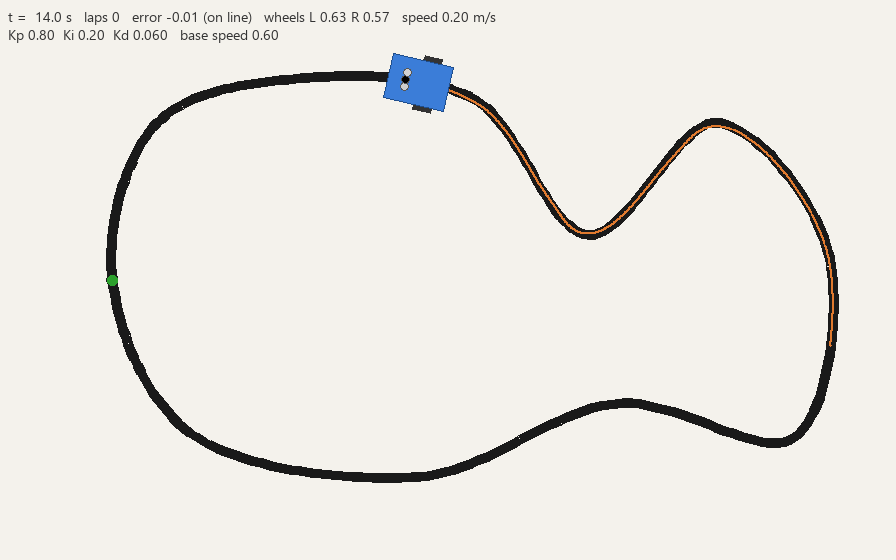
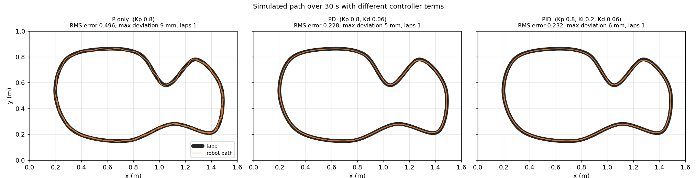
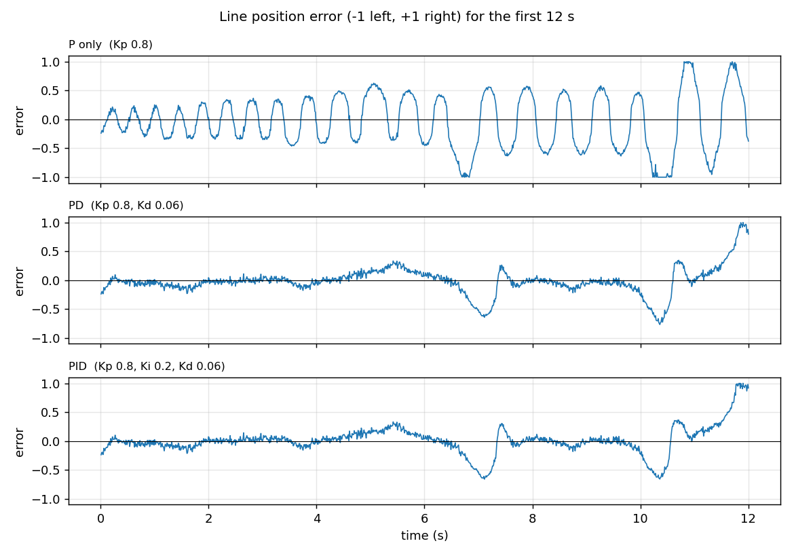
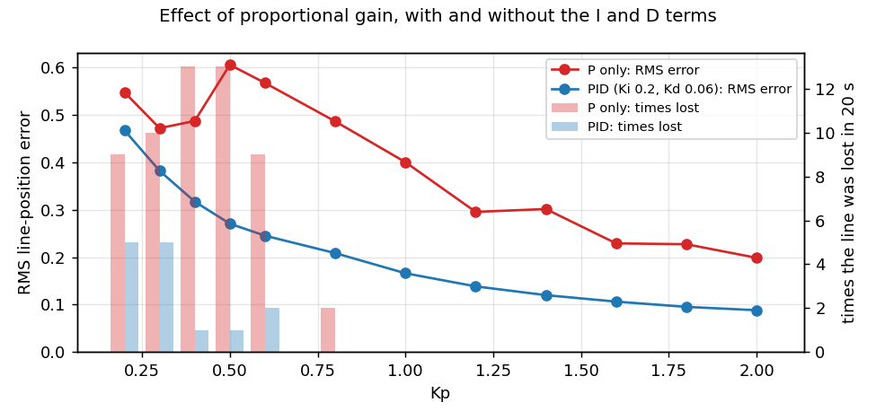

# PID Line-Following Robot

A small two-wheeled robot that follows a black tape line using three infrared reflectance sensors and a PID controller, running MicroPython on a Raspberry Pi Pico W. Built for a first-year robotics module at Manchester Metropolitan University, where it won the Best Design award.


The repository contains the robot firmware and a top-down simulation that runs the same controller code against a model of the robot and track. The simulation was written afterwards to show how the P, I and D terms behave without needing the hardware.



## What it does

- **Follows a line.** Three analogue reflectance sensors are combined into a single line-position error from -1 (line under the left sensor) to +1 (under the right). A PID controller turns that error into a steering correction that speeds up one wheel and slows the other.
- **Calibrates itself.** On start-up the robot samples each sensor over the white board and the black tape, so the three modules are normalised to the same 0 to 1 scale regardless of their individual sensitivity.
- **Recovers from losing the line.** If every sensor reads white, the robot keeps steering towards the side it last saw the line on rather than driving straight off.
- **Prints its state over USB** every half second so the gains can be tuned live from Thonny.

The simulation reproduces this with a differential-drive model that includes motor lag, a weaker left motor, stiction and sensor noise, and provides sliders for the gains, buttons to nudge the robot off the line, and live error statistics.

## Hardware

| Part | Notes |
|---|---|
| Raspberry Pi Pico W | MicroPython. Only three ADC inputs, which is exactly the number of sensors |
| 3 x TCRT5000 reflectance modules | Analogue outputs on GP26, GP27, GP28, about 12 mm apart on a bar ahead of the wheels |
| 2 x N20 micro metal gearmotors | With 32 mm wheels and a rear castor |
| DRV8833 dual H-bridge | Two PWM pins per motor (GP2/3 left, GP4/5 right) at 10 kHz |
| 3 x AA cells (4.5 V) | Powers the motors directly and the Pico through VSYS |
| Push button on GP14 | Start calibration, start running, stop |
| 3D-printed chassis | Two decks: battery and driver below, Pico and sensor bar in front |

Track: 19 mm black electrical tape on white card, with straights, gentle curves, an S-bend and one tight corner.

## Software

- Firmware: MicroPython 1.22 or newer on the Pico W. No libraries beyond `machine` and `time`.
- Simulation: Python 3.10 or newer. The live simulator needs only the standard library (Tkinter). The plotting script needs `matplotlib`; the snapshot option needs `pillow`.

```
firmware/
  main.py          start-up sequence and the 100 Hz control loop
  controller.py    PID class, line-position calculation, wheel mixing  (shared with the simulation)
  sensors.py       ADC reading and calibration
  motors.py        DRV8833 PWM driver
  config.py        pins, gains, speeds
simulation/
  simulate.py      Tkinter top-down animation with live sliders
  simulator.py     ties the controller to the robot model and track
  robot.py         differential-drive model with lag, mismatch, stiction and noise
  track.py         spline track and reflectance model of the tape
  plot_run.py      headless runs that produce the plots below
docs/              images for this README
```

## How to run

**Robot**

1. Flash MicroPython to the Pico W.
2. Copy everything in `firmware/` to the Pico (Thonny: open each file, *File > Save as > Raspberry Pi Pico*). `main.py` runs automatically at power-on.
3. Press the button once. While the LED blinks, slide the robot sideways across the tape a few times so every sensor sees both black and white.
4. When the LED stays on, place the robot on the line and press the button again. Press once more to stop.

Pins, gains and speeds are all in `firmware/config.py`.

**Simulation**

```bash
git clone https://github.com/siamct/pid-line-following-robot.git
cd pid-line-following-robot/simulation
python simulate.py
```

Press `Space` to start, `R` to reset, use the sliders to change the gains, and `Nudge` to push the robot 3 cm off the line. To regenerate the plots:

```bash
pip install -r requirements.txt
python plot_run.py
```

## Results

Simulated runs of 30 s on the default track at a base speed of 0.6 (about 0.2 m/s):

| Controller | RMS error | Max deviation from line | Times line lost |
|---|---|---|---|
| P only (Kp 0.8) | 0.50 | 9 mm | 2 |
| PD (Kp 0.8, Kd 0.06) | 0.23 | 5 mm | 0 |
| PID (Kp 0.8, Ki 0.2, Kd 0.06) | 0.23 | 6 mm | 0 |





With only a proportional term the robot weaves from side to side and the weave grows until it loses the line on the tight corner. Adding the derivative term damps it almost completely. The integral term makes little difference in the simulation because the only steady offset is the weaker left motor; on the real robot it helped more because the motors were less well matched than the model.



Below about Kp 0.6 the robot cannot turn hard enough for the tight corner and loses the line on most laps. Higher Kp keeps reducing the error in simulation; on the real robot the limit came sooner, as gearbox backlash and sensor noise made it shake on the straights.

The physical robot completed the competition track without leaving the line and took the Best Design award for the overall build. The gains in `config.py` are the ones that ended up on the robot after a lot of trial and error.

## What I learned

- **Normalise before you combine.** The three sensors gave noticeably different raw values over the same surface. Without per-sensor calibration the weighted average was biased to one side and the robot hugged one edge of the tape.
- **D is the term that stops the weave.** Tuning P alone could make the robot either sluggish or oscillating, never both quick and smooth. A small derivative gain was the single biggest improvement.
- **Derivative amplifies noise.** At 100 Hz, a few percent of sensor noise turns into visible jitter on the wheels through the D term. Keeping Kd small and the sensors shielded from room light mattered more than expected.
- **Decide what to do when the line is gone.** Remembering which side the line was last seen on turned corner exits from a coin toss into a reliable recovery.
- **Separate logic from hardware.** Putting the controller in a file with no `machine` imports meant the same code could be driven by a simulation, which made it much easier to explain and to tune.

## Licence

MIT. See [LICENSE](LICENSE).
